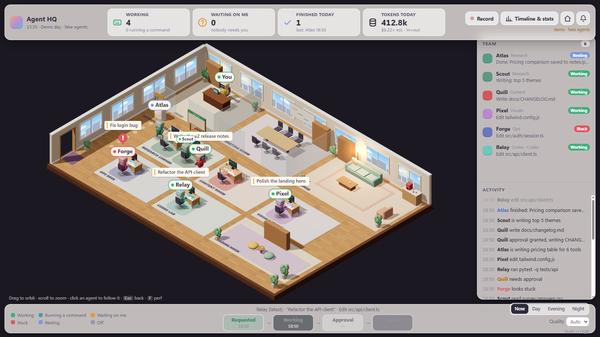

# Agent HQ

[](https://github.com/ikooq/agent-hq/actions/workflows/test.yml)

A live 3D office for your Claude Code and Codex agents. Each bot sits at a desk and shows what it is working on, what it is waiting for, and when it gets stuck. It runs on your computer with no dependencies to install.



See it without any setup of your own: start the server and open http://127.0.0.1:7777/?demo=1. The demo is a scripted day with fake agents, and it is what the screenshot shows.

## Install

You need [Node.js](https://nodejs.org) 20 or newer (22 recommended) and git.

On Windows:

```powershell
git clone https://github.com/ikooq/agent-hq.git
powershell -ExecutionPolicy Bypass -File agent-hq\install.ps1
```

The installer copies the code to `~/.agent-hq`, backs up `~/.claude/settings.json` and adds the hooks next to your existing ones. It copies the subagents to `~/.claude/agents` and asks before overwriting one you changed. It creates `roster.json` from `roster.example.json`, adds a hidden Startup shortcut and the `agent-hq` command, then starts the server at http://127.0.0.1:7777/. Running it again is safe.

| Option | Effect |
| --- | --- |
| `-NoAgents` | Leave `~/.claude/agents` alone |
| `-NoAutostart` | No Startup shortcut |
| `-NoShim` | No `agent-hq` command |
| `-NoStart` | Do not start the server at the end |
| `-Yes` | Overwrite changed subagents without asking (a backup is kept) |

`install.ps1` is Windows only. On macOS or Linux, clone the repo to `~/.agent-hq` and run `node cli.js install`, which adds the hooks and the roster but no autostart or command. The tests also run on Ubuntu; the installer has only been tried on Windows.

Then edit `~/.agent-hq/roster.json` so each bot's `folders` match your projects. Sessions in other folders still show up as drop-in bots.

**To uninstall:** `powershell -ExecutionPolicy Bypass -File $HOME\.agent-hq\uninstall.ps1`. This removes only the Agent HQ hooks, the shortcut and the command. It asks before removing the subagents or deleting `~/.agent-hq`.

## Commands

| Command | What it does |
| --- | --- |
| `agent-hq start` / `stop` / `restart` | Control the background server |
| `agent-hq status` | Live counts for each bot |
| `agent-hq open` | Start if needed and open the office |
| `agent-hq report` | Write today's report to `~/.agent-hq/reports/` (`--date=YYYY-MM-DD` for another day); one is also written at 23:00 |
| `agent-hq approvals on` / `off` | Allow once or Deny Claude Code permission prompts from the office (off by default; `on --lan` also allows it from the phone) |
| `agent-hq lan on` / `off` | Read-only office on your phone over home Wi-Fi, through a token link and QR code (off by default) |
| `agent-hq test` | Self-test against a temporary home folder |
| `agent-hq bench` | 60-second browser benchmark with 15 fake agents (needs Chrome or Edge) |
| `agent-hq soak --minutes=60` | Long run on a temporary home folder to catch leaks and slowdowns |
| `agent-hq install` / `uninstall` | Add or remove the hooks, autostart and command |

In the office, **Record** saves the view as a WebM video, and each desk shows its project's git branch, uncommitted files and unpushed commits, with a button to open the folder in VS Code.

## Privacy

Everything stays on your computer.

- **No network calls:** there is no telemetry, no model calls and no npm dependencies. Three.js is vendored in `vendor/`.
- **Local by default:** the server binds to `127.0.0.1`. Only `agent-hq lan on` opens it to your local network, and that link needs a token.
- **What it reads:** Claude Code transcripts and Codex logs, read-only, plus `git status` for the folders on your roster.
- **What it writes:** hook events, stats and reports in `~/.agent-hq`. These files and your `roster.json` are gitignored, so they stay out of the repo.

Costs in the office are estimates from `prices.json`, not billing data.

## How it fits together

- `hook.js`: Claude Code hook that appends one line per event to `events-YYYY-MM.jsonl`
- `core.js`: turns hook events, transcripts and Codex logs into office state
- `server.js`: HTTP server with `/state`, the `/events` stream, timeline and stats
- `web/`: the Three.js office, demo mode and recorder
- `cli.js`: the `agent-hq` command
- `report.js`, `approvals.js`, `lan.js`, `git.js`: daily report, approvals, phone mode, git on desks
- `roster.example.json`: starter roster; `prices.json`: model prices for cost estimates
- `claude/`: the subagents and a sample of the hooks block
